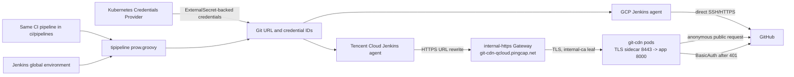
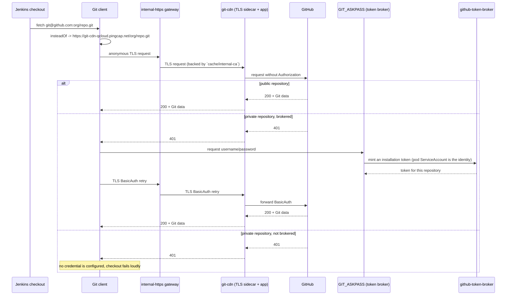

# Jenkins Git CDN Authentication

This document describes how the Jenkins shared library and the cluster
configuration cooperate when GitHub URLs are routed through git-cdn.

## Architecture



JCasC supplies only the global credential IDs and feature flags; it does not
contain a copy of any GitHub credential. The SSH key comes from the Kubernetes
Credentials Provider, and the HTTP credential is the broker token minted per
checkout.

## Transport encryption

The credential being forwarded to GitHub is a long-lived organization PAT, so
the hop that carries it must be encrypted end to end:

| Hop | Transport |
| --- | --- |
| Jenkins agent → `internal-https` gateway | TLS, `*.pingcap.net` wildcard certificate |
| gateway → git-cdn pod | TLS, re-encrypted by Envoy Gateway (`BackendTLSPolicy`), verified against the cluster-internal CA |
| git-cdn pod: TLS sidecar → git-cdn app | plaintext, but on the pod loopback only |
| git-cdn → GitHub | TLS (`GITSERVER_UPSTREAM=https://github.com/`) |

The pieces live in `apps/tencentcloud/cache/git-cdn/`:

- `certificate.yaml` — `internal-ca`-issued certificate for
  `git-cdn.cache.svc`, mounted into the `tls` sidecar;
- `tls-proxy-config.yaml` + the HelmRelease `postRenderers` — nginx sidecar that
  terminates TLS on 8443 and proxies to the app on `127.0.0.1:8000`, plus the
  Service port it listens on;
- `httproute-internal.yaml` — `git-cdn-qcloud.pingcap.net` on the
  `infra/internal-https` Gateway;
- `backendtlspolicy.yaml` — tells Envoy Gateway to verify and re-encrypt to the
  pod instead of downgrading the second hop to cleartext.

The CA certificate that the gateway verifies against is published by
trust-manager (`infrastructure/tencentcloud/cert-manager/post/internal-ca-bundle.yaml`)
as the `cache/internal-ca` ConfigMap. The CA key never leaves `cert-manager`.

## Authentication flow



Git does not query repository visibility before the request. It first tries
without credentials and invokes `GIT_ASKPASS` only when the HTTP server asks
for credentials, so public repositories never carry one. Private repositories
must be covered by the broker allowlist (`GIT_BROKER_ORGS` / `GIT_BROKER_REPOS`):
the long-lived PAT this path used to send (`github-bot-https`) has been removed,
and there is no fallback that would silently hand a durable token to the cache —
a repository missing from the allowlist fails instead.

## URL behavior

Tencent Cloud (prod and staging) configures the following Git rewrite rules:

```text
https://github.com/       -> https://git-cdn-qcloud.pingcap.net/
git@github.com:            -> https://git-cdn-qcloud.pingcap.net/
ssh://git@github.com/      -> https://git-cdn-qcloud.pingcap.net/
```

The host name carries the cluster. Both clusters run a `*.pingcap.net` internal
gateway, on a different address each, so a cluster-agnostic name would resolve
to one cluster and silently redirect the other cluster's agents across the
network. Tencent Cloud therefore uses `-qcloud`; a GCP instance would use
`-gcp` (GCP has `GIT_CDN_ENABLED=false` today).

`GIT_CDN_URL` must match the rewrite target; the shared library uses it for the
explicit rewrites in `component.checkout*`, while the `url.*.insteadOf` entries
above cover the shell `git` invocations inside the pipelines.

GCP does not configure these rules (`GIT_CDN_ENABLED=false`). Its existing
direct Git transport behavior is unchanged, while the same credential IDs are
available for the shared CI library.

The original `refs/pull/<number>/head` and `refs/pull/<number>/merge` refspecs
are unchanged. URL rewriting affects the transport only.

## Credential responsibilities

| Credential | Jenkins ID | Use |
| --- | --- | --- |
| SSH private key | `github-sre-bot-ssh` | Direct GitHub SSH access when CDN routing is disabled |
| GitHub API PAT | `github-bot-token` | Existing API operations |

There is no HTTP transport credential. `GIT_HTTP_CREDENTIALS_ID` is unset, and
the `github-bot-https` ExternalSecret is gone with it: a checkout that reaches a
private repository authenticates through the broker, never with a static token
handed to the cache.

The SSH key is still created by the Kubernetes Credentials Provider from
`pre/credential-github.yaml`; the shared library reads `GIT_SSH_CREDENTIALS_ID`
from the Jenkins environment (a credential ID, not a secret value).

Organizations in `GIT_BROKER_ORGS` plus the single repositories in
`GIT_BROKER_REPOS` (`tidbcloud`, `pingcap-inc`, and `PingCAP-QE/tidb-test`) are
the set that may use this cache at all: the broker mints a GitHub App
installation token per repository, and the policy in the broker decides what may
be minted.

## Cache and security requirements

The CDN must return 401 for an unauthenticated private repository request.
Returning 404 prevents Git from invoking `GIT_ASKPASS`.

An authenticated private request must not make private Git data available to
later unauthenticated requests from the cache. This must be tested explicitly
before enabling the rewrite for private repositories.

The endpoint is internal-only: the `internal-https` Gateway address
(`10.0.6.5`) is not reachable from outside the corporate network, and no
external Gateway route points at git-cdn.

The plaintext listener no longer has a service: the app still listens on
`127.0.0.1:8000` inside the pod, which is where the TLS sidecar proxies to, but
the Service only publishes `https:8443`. The chart's `helm test` hook was moved
to the TLS port for the same reason, so a release cannot reintroduce a plaintext
endpoint without failing.

## Rollout and rollback

The `ci` change is feature-gated by `GIT_CDN_ENABLED`. Without that variable,
the existing checkout behavior remains unchanged.

The rollout order is:

1. Merge the `ci` shared library PR.
2. Merge this `ee-ops` PR and allow Flux to reconcile the Jenkins instances.
3. Validate a TiFlash job with recursive submodules in GCP and Tencent Cloud.

Rollback is performed by setting `GIT_CDN_ENABLED=false` and removing the
three Tencent rewrite entries. Jenkins then returns to direct SSH/HTTPS
behavior without changing the CI pipeline files.

Going back to the plaintext cache is deliberately not a one-line rollback any
more: the port, the PAT and the host name are gone. Restoring it means
re-adding the Service port, the `github-bot-https` ExternalSecret and
`GIT_HTTP_CREDENTIALS_ID`, which is the review this change exists to prevent.
