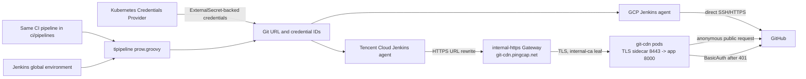
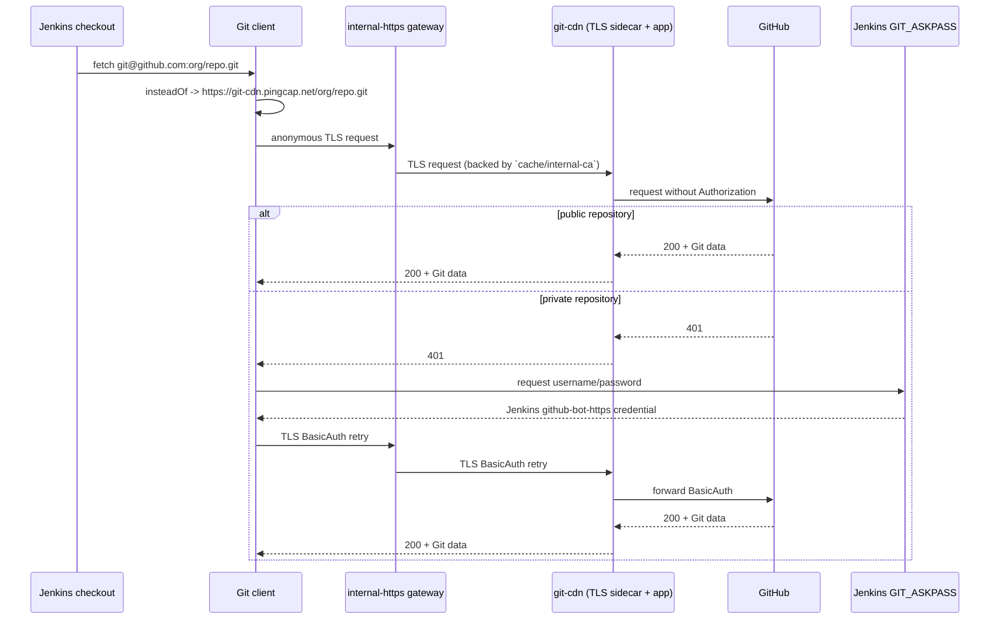

# Jenkins Git CDN Authentication

This document describes how the Jenkins shared library and the cluster
configuration cooperate when GitHub URLs are routed through git-cdn.

## Architecture



The `github-bot-https` credential is generated by the Kubernetes Credentials
Provider from the existing `github-bot-username` and `github-bot-token`
secrets. JCasC only supplies the global credential IDs and feature flags; it
does not contain a second copy of the GitHub credential.

## Transport encryption

The credential being forwarded to GitHub is a long-lived organization PAT, so
the hop that carries it must be encrypted end to end:

| Hop | Transport |
| --- | --- |
| Jenkins agent → `internal-https` gateway | TLS, `*.pingcap.net` wildcard certificate |
| gateway → git-cdn pod | TLS, re-encrypted by Envoy Gateway (`BackendTLSPolicy`), verified against the cluster-internal CA |
| git-cdn pod: TLS sidecar → git-cdn app | plaintext, but on the pod loopback only |
| git-cdn → GitHub | TLS (`GITSERVER_UPSTREAM=https://github.com/`) |

The pieces live in `apps/tencentcloud/cache/git-cdn/`:

- `certificate.yaml` — `internal-ca`-issued certificate for
  `git-cdn.cache.svc`, mounted into the `tls` sidecar;
- `tls-proxy-config.yaml` + the HelmRelease `postRenderers` — nginx sidecar that
  terminates TLS on 8443 and proxies to the app on `127.0.0.1:8000`, plus the
  Service port it listens on;
- `httproute-internal.yaml` — `git-cdn.pingcap.net` on the `infra/internal-https`
  Gateway;
- `backendtlspolicy.yaml` — tells Envoy Gateway to verify and re-encrypt to the
  pod instead of downgrading the second hop to cleartext.

The CA certificate that the gateway verifies against is published by
trust-manager (`infrastructure/tencentcloud/cert-manager/post/internal-ca-bundle.yaml`)
as the `cache/internal-ca` ConfigMap. The CA key never leaves `cert-manager`.

## Authentication flow



Git does not query repository visibility before the request. It first tries
without credentials and invokes `GIT_ASKPASS` only when the HTTP server asks
for credentials. This keeps the PAT out of public repository requests, and the
retry that does carry it is TLS-only.

## URL behavior

Tencent Cloud (prod and staging) configures the following Git rewrite rules:

```text
https://github.com/       -> https://git-cdn.pingcap.net/
git@github.com:            -> https://git-cdn.pingcap.net/
ssh://git@github.com/      -> https://git-cdn.pingcap.net/
```

`GIT_CDN_URL` must match the rewrite target; the shared library uses it for the
explicit rewrites in `component.checkout*`, while the `url.*.insteadOf` entries
above cover the shell `git` invocations inside the pipelines.

GCP does not configure these rules (`GIT_CDN_ENABLED=false`). Its existing
direct Git transport behavior is unchanged, while the same credential IDs are
available for the shared CI library.

The original `refs/pull/<number>/head` and `refs/pull/<number>/merge` refspecs
are unchanged. URL rewriting affects the transport only.

## Credential responsibilities

| Credential | Jenkins ID | Use |
| --- | --- | --- |
| SSH private key | `github-sre-bot-ssh` | Direct GitHub SSH access when CDN routing is disabled |
| GitHub username and PAT | `github-bot-https` | HTTP authentication to git-cdn after a 401 |
| GitHub API PAT | `github-bot-token` | Existing API operations and the source for the HTTP credential |

The first two Git transport credentials are created by the Kubernetes
Credentials Provider from ExternalSecrets in `pre/credential-github.yaml`.
The shared library reads `GIT_SSH_CREDENTIALS_ID` and
`GIT_HTTP_CREDENTIALS_ID` from the Jenkins environment. These values are
credential IDs, not secret values.

SAML-enforcing organizations (`tidbcloud`, `pingcap-inc`) do not use this path:
`GIT_BROKER_ENABLED` mints a GitHub App installation token instead, and the
repository list that may be minted is the broker policy's business, not this
document's.

## Cache and security requirements

The CDN must return 401 for an unauthenticated private repository request.
Returning 404 prevents Git from invoking `GIT_ASKPASS`.

An authenticated private request must not make private Git data available to
later unauthenticated requests from the cache. This must be tested explicitly
before enabling the rewrite for private repositories.

The endpoint is internal-only: the `internal-https` Gateway address
(`10.0.6.5`) is not reachable from outside the corporate network, and no
external Gateway route points at git-cdn. Adding a NetworkPolicy that admits
only the Jenkins agent namespaces plus `envoy-gateway-system` is still open —
today the plaintext port 8000 remains reachable in-cluster for consumers that
have not migrated.

## Rollout and rollback

The `ci` change is feature-gated by `GIT_CDN_ENABLED`. Without that variable,
the existing checkout behavior remains unchanged.

The rollout order is:

1. Merge the `ci` shared library PR.
2. Merge this `ee-ops` PR and allow Flux to reconcile the Jenkins instances.
3. Validate a TiFlash job with recursive submodules in GCP and Tencent Cloud.

Rollback is performed by setting `GIT_CDN_ENABLED=false` and removing the
three Tencent rewrite entries. Jenkins then returns to direct SSH/HTTPS
behavior without changing the CI pipeline files. A `GIT_CDN_URL` /
`insteadOf` pair that points back at `http://git-cdn.cache.svc:8000` restores
the previous plaintext transport as long as the 8000 listener is still there.
